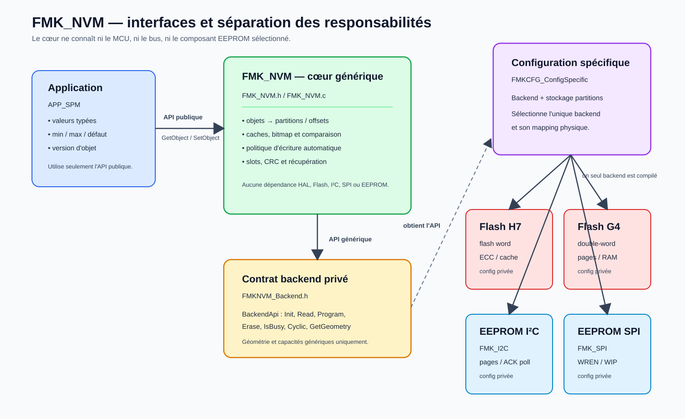
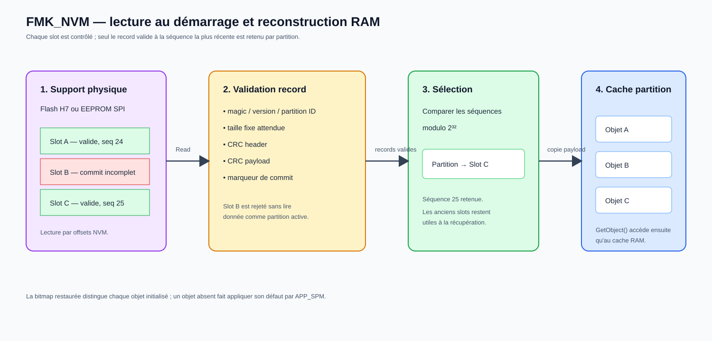
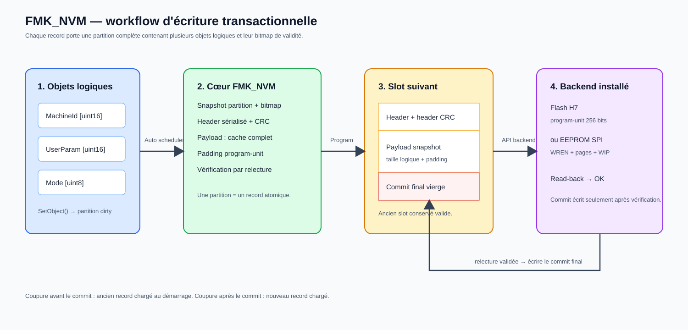

# Spécification d’architecture — FMK_NVM

## 1. Objet

`FMK_NVM` fournit à l’application une persistance asynchrone d’objets
logiques. Il masque le support physique sélectionné : Flash interne STM32H753,
Flash STM32G4, EEPROM I²C ou EEPROM SPI.

Le module distingue strictement :

- l’objet logique, qui est une valeur ou une structure applicative de taille
  fixe ;
- la partition transactionnelle, qui regroupe plusieurs objets logiques et
  constitue l’unité de restauration et d’écriture ;
- le slot, qui est une copie physique versionnée d’une partition ;
- le backend, qui réalise les accès physiques sans connaître les objets.

L’application n’impose jamais le moment d’une écriture. Un appel à
`FMKNVM_SetObject()` modifie uniquement le cache RAM. `FMKNVM_Cyclic()`
détermine ensuite automatiquement quand la partition concernée doit être
enregistrée.

Contraintes : C11, allocation statique, aucune écriture en interruption,
aucun handle HAL exposé à l’application et aucune API publique de commit.

## 2. Modèle de données

### 2.1 Objet logique

Un objet logique représente exactement une valeur ou une structure
applicative :

- identifiant `t_eFMKNVM_ObjectId` ;
- partition propriétaire ;
- offset fixe dans le cache de cette partition ;
- taille fixe en octets ;
- version logique.

`FMK_NVM` traite l’objet comme une suite d’octets. Il ne connaît ni son type,
ni ses bornes, ni sa valeur par défaut.

### 2.2 Partition transactionnelle

Une partition contient un ensemble d’objets logiques. Elle possède :

- un cache RAM sérialisé ;
- une bitmap persistante indiquant les objets déjà initialisés ;
- une capacité de payload fixe ;
- une version de format ;
- une temporisation après la dernière modification ;
- une durée maximale de report ;
- un intervalle minimal entre deux écritures.

La partition est l’unité atomique. Lorsqu’un seul objet change, toute l’image
cohérente de la partition est enregistrée dans un nouveau slot. Après une
coupure d’alimentation, le module restaure le dernier record intégralement
validé.

### 2.3 Slot et record

Une partition physique contient plusieurs slots rotatifs. Chaque record
comprend :

1. un header avec magic, version de partition, identifiant de partition,
   génération, taille de payload et CRC ;
2. l’image sérialisée de la partition ;
3. un marqueur de commit programmé en dernier.

Un record n’est valide que si le header, son CRC, le payload, son CRC et le
marqueur final sont valides. Une coupure avant le marqueur laisse donc le
record précédent utilisable.

### 2.4 Backend

Le backend ne connaît ni objet logique, ni type applicatif, ni politique
temporelle. Il expose seulement une géométrie et les opérations génériques
`Init`, `GetGeometry`, `GetCapabilities`, `Read`, `Program`, `Erase`,
`IsBusy`, `GetOperationResult` et `Cyclic`.

Son `context_pv` est opaque pour le cœur. Il désigne les données privées
nécessaires au backend sélectionné. Les éléments comme une ligne I²C, une
adresse de composant, une taille de page EEPROM, des opcodes SPI ou une banque
Flash ne traversent pas l’interface générique.

## 3. Architecture globale



```text
APP_SPM
  │  valeur typée, min, max, défaut, version
  │
  ├── FMKNVM_GetObject(objectId, buffer, taille exacte)
  └── FMKNVM_SetObject(objectId, buffer, taille exacte)
               │
               ▼
FMK_NVM
  objet -> partition + offset + taille
  comparaison du cache et marquage dirty
  politique temporelle et transaction atomique
               │
               ▼
FMKNVM_BackendApi
  Read / Program / Erase / état asynchrone
               │
               ▼
Flash H753, Flash G4, EEPROM I²C ou EEPROM SPI
```

`APP_SPM` possède la sémantique du paramètre. `FMK_NVM` possède la
sérialisation, les caches, les partitions, les délais et l’accès au backend.
Le backend possède exclusivement les contraintes du composant physique.

## 4. Répartition des fichiers

| Fichier | Responsabilité |
|---|---|
| `FMK_NVM.h` | API publique objet et diagnostics par partition. |
| `FMK_NVM.c` | restauration, caches, comparaison, ordonnanceur automatique, transaction et CRC. |
| `FMKNVM_Backend.h` | contrat générique injecté au cœur. |
| `FMKNVM_ConfigPublic.h` | identifiants publics des objets et partitions. |
| `FMKNVM_ConfigPrivate.h` | type EEPROM choisi, caches, politiques de partition et mapping logique des objets. |
| `FMKNVM_ConfigSpecific.h/.c` | sélection de l’API et du mapping physique associés au type EEPROM. |
| `FMKNVM_BackendFlashH753.h/.c` | implémentation physique Flash du STM32H753. |
| `APPSPM_ConfigPrivate.h` | type, limites, défaut, version et objet NVM de chaque paramètre. |
| `APP_SPM.c` | restauration typée, contrôle min/max et publication des changements. |

La configuration logique n’embarque aucun détail de bus ou de MCU. La
configuration physique n’embarque aucune règle métier sur les paramètres.

`FMKNVM_EEPROM_TYPE` sélectionne le support du projet parmi
`FLASH_H753`, `FLASH_G4`, `I2C` et `SPI`. Les fonctions ConfigSpecific
utilisent cette valeur unique pour fournir une API backend et le mapping
physique correspondant. Un choix dont l’implémentation n’est pas intégrée
produit explicitement `NULL` ou `RC_ERROR_NOT_SUPPORTED`.

## 5. Configuration

### 5.1 Configuration publique

```c
typedef enum __t_eFMKNVM_PartitionId
{
    FMKNVM_PARTITION_USER_PARAMETERS,
    FMKNVM_PARTITION_CALIBRATION,
    FMKNVM_PARTITION_COUNTERS,
    FMKNVM_PARTITION_NB
} t_eFMKNVM_PartitionId;

typedef enum __t_eFMKNVM_ObjectId
{
    FMKNVM_OBJECT_APPSPM_MACHINE_ID,
    FMKNVM_OBJECT_NB
} t_eFMKNVM_ObjectId;
```

Un projet peut déclarer de nombreux objets de petite taille, par exemple
150 paramètres `t_uint16`. Ils sont placés à des offsets distincts dans une ou
plusieurs partitions. Le nombre d’objets n’impose pas autant de secteurs Flash
ou de transactions physiques.

### 5.2 Configuration logique privée

```c
typedef struct __t_sFMKNVM_PartitionDescriptor
{
    t_uint8 * cacheData_pu8;
    t_uint32 payloadCapacity_u32;
    t_uint16 formatVersion_u16;
    t_uint32 quietPeriodMs_u32;
    t_uint32 maximumDeferredCommitMs_u32;
    t_uint32 minimumCommitIntervalMs_u32;
} t_sFMKNVM_PartitionDescriptor;

typedef struct __t_sFMKNVM_ObjectDescriptor
{
    t_eFMKNVM_PartitionId partitionId_e;
    t_uint32 offset_u32;
    t_uint32 size_u32;
    t_uint16 version_u16;
} t_sFMKNVM_ObjectDescriptor;
```

Les objets d’une même partition ne doivent pas se chevaucher. Leur fin doit
rester dans `payloadCapacity_u32`. Ces règles sont vérifiées pendant la
configuration du module.

La version de partition décrit le format de l’image complète. Elle doit être
incrémentée lorsque le mapping ou la représentation sérialisée devient
incompatible. La version d’objet est exposée à `APP_SPM`, qui peut alors
rejeter une ancienne valeur et appliquer son défaut.

Les premiers octets de chaque cache sont réservés à la bitmap de validité.
Les offsets des objets commencent après
`FMKNVM_OBJECT_VALIDITY_BITMAP_SIZE`. La bitmap est enregistrée avec la
partition : initialiser un premier objet ne rend donc pas les autres objets
disponibles.

### 5.3 Configuration physique spécifique

```c
typedef struct __t_sFMKNVM_PartitionStorageCfg
{
    t_uint32 storageOffset_u32;
    t_uint32 storageSize_u32;
    t_uint16 slotCount_u16;
} t_sFMKNVM_PartitionStorageCfg;
```

`FMKNVM_Specific_GetPartitionStorage()` copie une entrée physique directement
dans le runtime de la partition demandée. Le cœur ne conserve ni pointeur
global vers une table ConfigSpecific, ni compteur redondant : le nombre
d’entrées est toujours `FMKNVM_PARTITION_NB`. Il valide ensuite les limites,
les alignements, la taille des slots et l’absence de chevauchement.

Pour l’intégration STM32H753 actuelle, la Bank 2 de 1 Mio est réservée à la
NVM. Trois zones de 256 Kio sont configurées, avec deux slots de 128 Kio par
partition :

| Partition | Offset Bank 2 | Taille | Slots |
|---|---:|---:|---:|
| paramètres utilisateur | `0` | 256 Kio | 2 |
| calibrations | 256 Kio | 256 Kio | 2 |
| compteurs | 512 Kio | 256 Kio | 2 |

Les 256 Kio restants sont non affectés et permettent une extension future.

Une EEPROM I²C ou SPI utilise généralement des zones et des pages d’écriture
beaucoup plus petites. Cela ne change pas le modèle logique : seul le mapping
physique et le découpage effectué par le backend changent.

## 6. API publique

```c
t_eReturnCode FMKNVM_Init(void);
t_eReturnCode FMKNVM_Cyclic(void);
t_eReturnCode FMKNVM_GetState(t_eCyclicModState * f_State_pe);
t_eReturnCode FMKNVM_SetState(t_eCyclicModState f_State_e);

t_eReturnCode FMKNVM_GetObjectInfo(   t_eFMKNVM_ObjectId f_ObjectId_e,
                                      t_sFMKNVM_ObjectInfo * f_Info_ps);

t_eReturnCode FMKNVM_GetObject(   t_eFMKNVM_ObjectId f_ObjectId_e,
                                  void * f_Data_pv,
                                  t_uint32 f_DataSize_u32);

t_eReturnCode FMKNVM_SetObject(   t_eFMKNVM_ObjectId f_ObjectId_e,
                                  const void * f_Data_pv,
                                  t_uint32 f_DataSize_u32);

t_eReturnCode FMKNVM_IsPartitionDirty(   t_eFMKNVM_PartitionId f_PartitionId_e,
                                         t_bool * f_IsDirty_pb);

t_eReturnCode FMKNVM_GetPartitionDiagnostics(   t_eFMKNVM_PartitionId f_PartitionId_e,
                                                t_sFMKNVM_Diagnostics * f_Diagnostics_ps);
```

`GetObject()` et `SetObject()` exigent exactement la taille configurée.
`GetObject()` lit uniquement le cache RAM. `SetObject()` conserve le pointeur
appelant uniquement pendant l’appel et retourne
`RC_WARNING_NO_OPERATION` lorsque les octets sont inchangés.

Il n’existe ni `RequestCommit`, ni `CommitSync`, ni `CommitAllSync`.

## 7. Restauration au démarrage



`FMKNVM_Init()` prépare uniquement les structures statiques et la FIFO. Les
accès physiques ont lieu progressivement dans la machine d’état de
`FMKNVM_Cyclic()` :

1. initialiser le backend ;
2. lire sa géométrie ;
3. lire ses capacités ;
4. valider la configuration logique et physique ;
5. analyser les slots de chaque partition ;
6. vérifier header, version, identifiant, marqueur et CRC ;
7. sélectionner la génération valide la plus récente ;
8. reconstruire le cache de la partition ;
9. passer le module en état opérationnel.

Une partition sans record valide reste indisponible, sans empêcher les autres
partitions d’être restaurées.

## 8. Modification et écriture automatique



Lors de `FMKNVM_SetObject()` :

1. vérifier l’identifiant et la taille exacte ;
2. retrouver la partition et l’offset de l’objet ;
3. comparer la valeur au cache ;
4. ne rien modifier si les octets sont identiques ;
5. copier la nouvelle valeur sinon ;
6. marquer la partition `dirty` et mémoriser le tick de modification.

À chaque `FMKNVM_Cyclic()`, le gestionnaire de commit examine au plus un
quantum borné. Une partition sale devient éligible lorsque :

- le `quietPeriodMs_u32` est écoulé depuis le dernier changement ; ou
- le `maximumDeferredCommitMs_u32` est atteint ;

et seulement si `minimumCommitIntervalMs_u32` est respecté.

La transaction :

1. prend un snapshot stable du cache complet ;
2. choisit le slot suivant ;
3. efface le slot si le backend l’exige ;
4. programme header et payload ;
5. relit et vérifie les données ;
6. programme le marqueur de commit en dernier ;
7. conserve `dirty` si un objet a changé pendant l’écriture ;
8. efface `dirty` uniquement si la génération enregistrée est toujours la
   génération courante.

Les temps sont obtenus avec `FMKCPU_GetTick()`. Aucun paramètre APPSPM ne
déclenche directement un accès Flash ou EEPROM.

## 9. Couplage avec APP_SPM

`APP_SPM` attend que `FMK_NVM` soit opérationnel, puis restaure au plus un
paramètre par appel cyclique.

Pour chaque paramètre persistant :

1. déterminer sa taille à partir de `t_eAPPSPM_PrmType` ;
2. vérifier la taille et la version annoncées par l’objet NVM ;
3. lire les octets avec `FMKNVM_GetObject()` ;
4. convertir selon le type APP_SPM ;
5. contrôler `minItemVal_f32` et `maxItemVal_f32` ;
6. utiliser `DefaultItemVal_f32` si l’objet est absent, corrompu,
   incompatible ou hors limites ;
7. publier ce défaut dans le cache NVM afin qu’il soit enregistré
   automatiquement selon la politique de sa partition.

Une taille ou une version incompatible n’est pas une erreur logicielle
APP_SPM. La valeur persistante est simplement abandonnée, le défaut devient
la valeur courante et il est envoyé à `FMKNVM_SetObject()`. Seules les erreurs
réelles de configuration — type inconnu, identifiant hors enum ou mapping
invalide — peuvent arrêter la machine de configuration APP_SPM.

Lorsqu’un paramètre change via l’API APP_SPM ou via APP_SIG, APP_SPM publie sa
valeur canonique vers l’objet associé. Il ne connaît ni offset, ni partition,
ni sérialisation, ni adresse physique.

`FMKNVM_OBJECT_NB` sert de sentinelle pour un paramètre volontairement
volatile.

### 9.1 Changement complet de configuration

Si toutes les partitions, tous les objets ou tous les paramètres sont
remappés, la version de format de chaque partition concernée doit être
incrémentée. Au démarrage suivant :

1. FMK_NVM rejette les records portant l’ancienne version de partition ;
2. les caches et bitmaps de ces partitions restent indisponibles ;
3. APP_SPM restaure chaque paramètre avec sa valeur par défaut ;
4. chaque défaut est publié comme nouvel objet logique ;
5. FMK_NVM regroupe ces changements et réécrit automatiquement chaque
   partition selon sa politique temporelle.

Changer uniquement `version_u8` dans APP_SPM et `version_u16` dans le
descripteur NVM ne suffit pas à identifier le format réellement stocké :
la version d’objet exposée est celle de la configuration compilée. Toute
modification d’offset, de taille, de type, d’identifiant ou d’appartenance à
une partition impose donc aussi l’incrément de `formatVersion_u16` de cette
partition. Cette règle évite qu’une ancienne suite d’octets soit interprétée
selon le nouveau mapping.

## 10. Diagnostic et maintenance

Les diagnostics sont portés par partition, car la partition est l’unité de
transaction. Ils indiquent notamment :

- présence d’un record valide ;
- état `dirty` ;
- génération restaurée et génération courante ;
- dernier résultat ;
- compteur d’écritures réussies ;
- compteur d’échecs et de vérifications invalides.

Une erreur d’écriture ne détruit pas le dernier slot valide. La partition
reste sale, le nombre de tentatives est borné et la machine d’état revient en
service afin que les autres partitions continuent d’être traitées.

## 11. Responsabilités

| Besoin | Responsable |
|---|---|
| Type, min, max, défaut d’un paramètre | `APP_SPM` |
| Association paramètre ↔ objet logique | configuration `APP_SPM` |
| Association objet ↔ partition/offset | `FMKNVM_ConfigPrivate.h` |
| Cache, comparaison et dirty | `FMK_NVM` |
| Politique et instant d’écriture | `FMK_NVM` |
| Mapping partition ↔ stockage | `FMKNVM_ConfigSpecific` |
| Contraintes page/secteur/bus | backend concret |
| Orchestration cyclique | `APP_SYS` |

Cette séparation permet d’ajouter des objets ou de modifier une politique de
partition sans changer `APP_SPM`, et de remplacer la Flash H753 par une
EEPROM sans changer la logique applicative.
